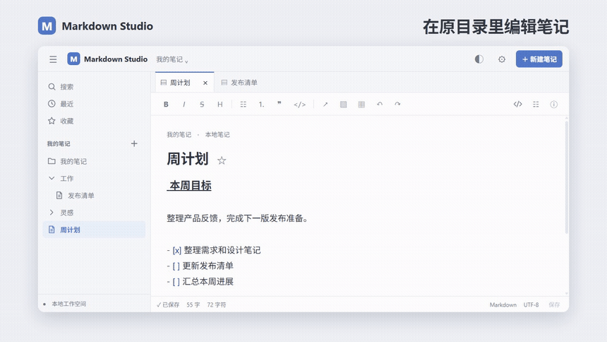

# Markdown Studio

**本地优先的 Markdown 桌面笔记应用。** 打开一个文件夹，就能整理、搜索和编辑其中的笔记。正文始终保存在原目录的 `.md` 文件里，也可以用其他编辑器打开。

[下载与发布](https://github.com/hackcpp/markdown-studio/releases) · [构建记录](https://github.com/hackcpp/markdown-studio/actions/workflows/build.yml) · [反馈问题](https://github.com/hackcpp/markdown-studio/issues)

## 产品演示

[](docs/media/markdown-studio-demo.mp4)

[观看完整版（15 秒，MP4）](docs/media/markdown-studio-demo.mp4)

## 功能

- **写作**：多标签编辑，实时预览与源码一键切换，支持 Markdown 格式工具栏、文档目录和浅色／深色主题。
- **整理**：以文件夹为工作区，在文件树中创建、重命名、移动笔记，或将其移至系统回收站／废纸篓。支持最近打开和收藏。
- **搜索**：按标题、正文和路径查找笔记，支持中文短词。SQLite 索引可从本地文件重建。
- **图片与元数据**：粘贴图片后自动保存到 `Attachments/images` 并插入相对链接。可在「文档信息」中编辑 YAML 标题和标签。
- **保存与恢复**：停笔约 800 毫秒后自动保存。重启可恢复工作区、标签页和编辑模式。异常退出后可恢复草稿，外部修改发生冲突时可以比较两版内容。

## 下载

在 [最新版本](https://github.com/hackcpp/markdown-studio/releases/latest) 的 **Assets** 中按设备选择安装包：

| 平台 | 安装包 | 格式 |
| --- | --- | --- |
| Windows x64 | `markdown-studio-<版本>-windows-x64.exe` | NSIS `.exe` |
| macOS Apple Silicon | `markdown-studio-<版本>-macos-arm64.dmg` | `.dmg` |
| macOS Intel | `markdown-studio-<版本>-macos-x64.dmg` | `.dmg` |

macOS 安装包未配置 Apple Developer ID 签名或公证。

## 快速上手

1. 打开应用，点击顶栏的「打开工作区」，选择已有 Markdown 文件夹或一个空文件夹。
2. 在左侧打开笔记，或点击「新建笔记」。右键单击文件或文件夹可以管理该条目。
3. 点击编辑工具栏的图标，在实时预览和源码之间切换。使用 `Ctrl+S`（Windows、Linux）或 `⌘S`（macOS）立即保存。
4. 点击左侧「搜索」，或按 `Ctrl+Shift+F`（macOS 为 `⌘⇧F`）搜索工作区。

如果检测到磁盘文件与草稿冲突，应用会暂停该笔记的自动保存。可比较两版内容并选择如何处理。显式覆盖前，应用会把磁盘版本备份到应用数据目录的 `recovery/`。

## 从源码运行

使用 Node.js 24 和 npm。在 Windows、macOS 或配有图形环境的 Linux 上，进入克隆后的仓库根目录执行：

```bash
git clone https://github.com/hackcpp/markdown-studio.git
cd markdown-studio
npm ci
npm run dev
```

在 Windows 上，直接使用 Windows 版 Node.js 和 Electron 构建、运行和测试。PowerShell 中可用 `npm.cmd` 执行相同命令。首次启动需要下载 Electron 运行时。

| 命令 | 用途 |
| --- | --- |
| `npm test` | 运行文件管理、搜索、元数据与恢复测试 |
| `npm run build` | 执行 TypeScript 检查并构建前端 |
| `npm run dist:win` | 在 Windows 上生成 NSIS 安装包 |
| `npm run dist:mac` | 在 macOS 上按当前架构生成 DMG |
| `npm run dist:linux` | 在 Linux 上生成 `.tar.gz` |

安装包输出到 `release/`。[Release build 工作流](.github/workflows/build.yml) 仅在 GitHub Release 发布时运行，使用 Release 标签指向的提交执行测试和打包。

### 推送前检查

克隆仓库后，在仓库根目录执行一次 `git config --local core.hooksPath .githooks` 启用 hook。推送时会检查待推送提交中的行尾空白、文件尾多余空行和 Tab 缩进，然后在当前工作区运行 `npm test`。任一步失败，Git 都会停止推送。测试其他分支前，先切换到对应分支。

推送到 `main` 后，[Main checks 工作流](.github/workflows/main-checks.yml) 会在 Windows 上用同一套规则检查提交格式，并运行 `npm test`。

## 产品设计

产品规格、已确认的交互与后续功能验收见[设计文档](docs/product/README.md)。
